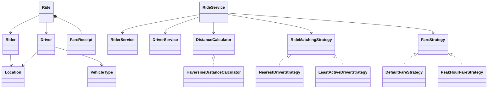

# RideWise Object Relationships

## 1. Relationship Summary

| Source | Target | Relationship | Explanation |
|---|---|---|---|
| `Rider` | `Ride` | Association | A ride refers to the rider who requested it. |
| `Driver` | `Ride` | Association | A ride refers to the driver assigned to it, if assignment succeeds. |
| `Ride` | `FareReceipt` | Composition / lifecycle ownership | The ride holds the fare receipt created for that ride. |
| `RideService` | `RiderService` | Dependency | The service looks up the rider requesting a ride. |
| `RideService` | `DriverService` | Dependency | The service obtains available drivers and updates driver state. |
| `RideService` | `RideMatchingStrategy` | Strategy dependency | A matching implementation is supplied for a ride request. |
| `RideService` | `FareStrategy` | Strategy dependency | A fare implementation calculates the fare. |
| `RideService` | `DistanceCalculator` | Dependency | Calculates pickup-to-destination distance. |
| `NearestDriverStrategy` | `DistanceCalculator` | Dependency | Uses distance calculations to compare drivers. |
| `Driver` | `VehicleType` | Enum value | Each driver records one vehicle type. |
| `Rider` | `Location` | Value reference | Pickup location is represented by coordinates. |
| `Driver` | `Location` | Value reference | Current driver location is represented by coordinates. |
| `Ride` | `Location` | Value reference | Destination coordinates are stored on the ride. |

## 2. Ride Request Interaction

1. `Main` collects the rider ID, destination coordinates, and matching-strategy choice.
2. `RideService` looks up the rider through `RiderService`.
3. `RideService` calls `DistanceCalculator` with the rider's pickup location and destination.
4. `RideService` obtains available drivers from `DriverService`.
5. The selected `RideMatchingStrategy` chooses a driver.
6. `RideService` creates the `Ride`, assigns the driver, calculates fare through `FareStrategy`, and attaches a `FareReceipt`.
7. Driver availability and active ride count are updated.
8. `RideConsoleView` displays the result.

## 3. Ride Lifecycle

```text
REQUESTED
    |
    | driver selected and assigned
    v
ASSIGNED
   / \
  /   \
 v     v
COMPLETED  CANCELLED
```

The exact allowed transitions are enforced by the methods in `Ride` and the lifecycle operations in `RideService`. In the current workflow, a successful request is assigned during the request operation; `COMPLETED` follows assignment, while cancellation is allowed only for states permitted by the implementation.

## 4. Composition versus Inheritance
RideWise favours composition: services are configured with strategy objects, and the peak-hour strategy delegates to a base fare strategy. The design does not require a deep inheritance hierarchy for matching or pricing variants.

## 5. Mermaid Class Relationship Sketch

